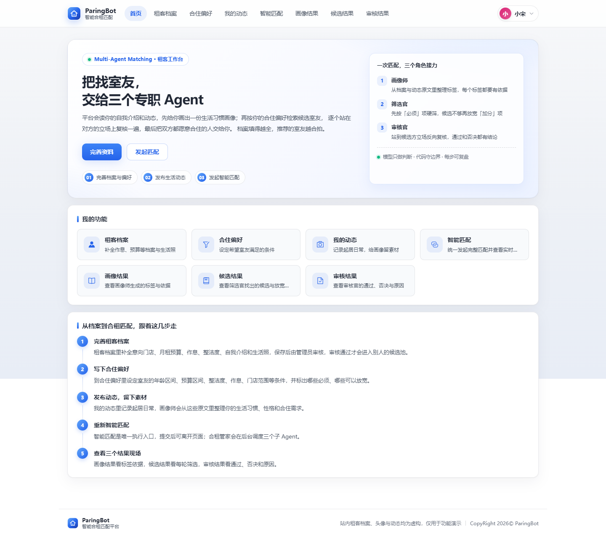
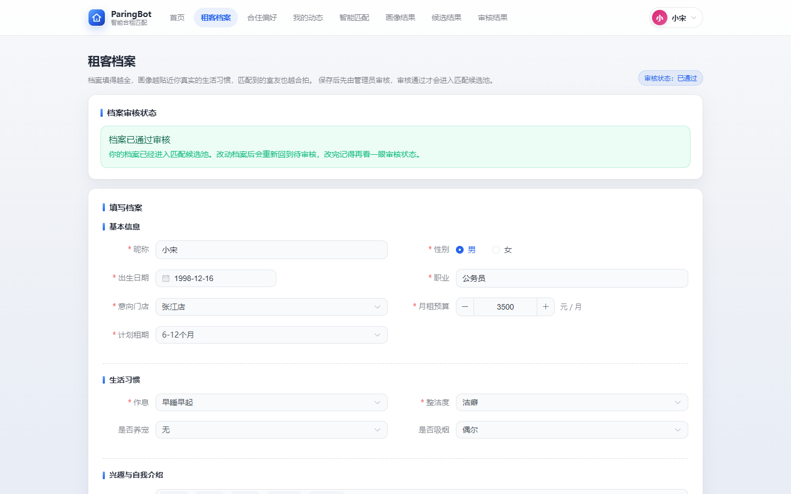
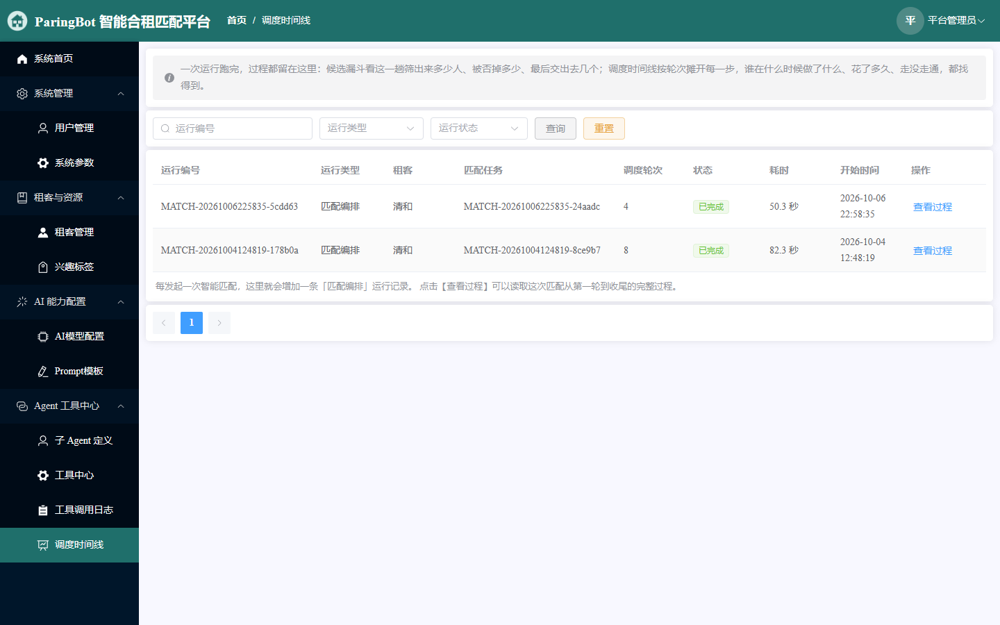
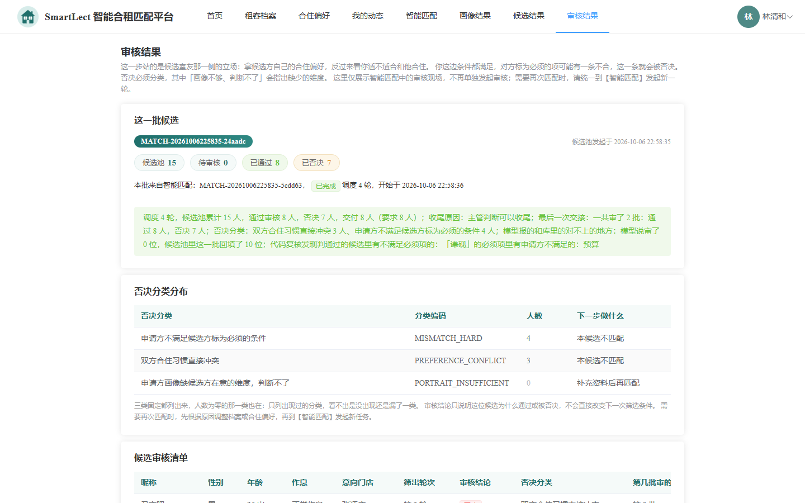
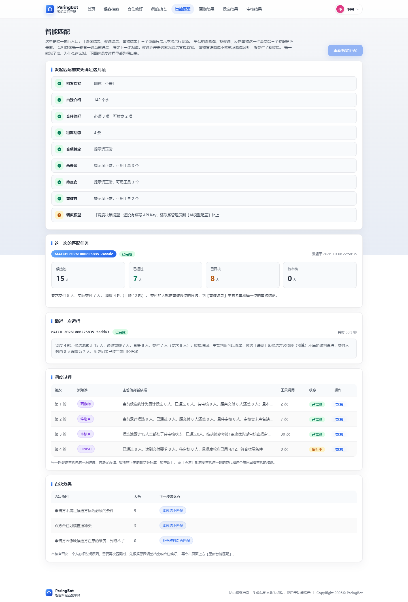
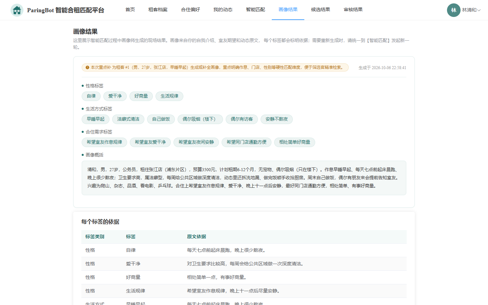
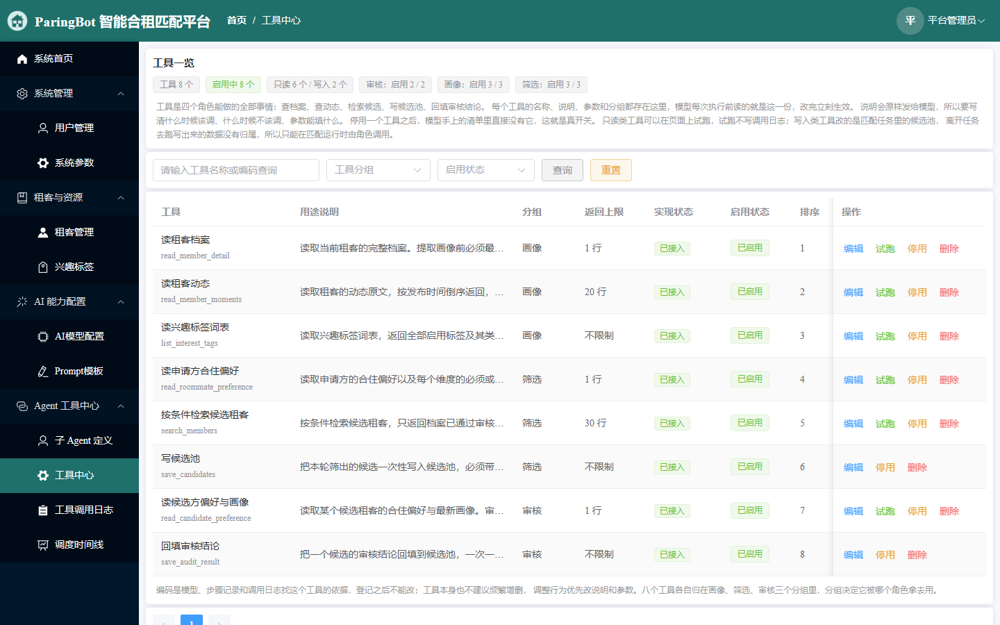
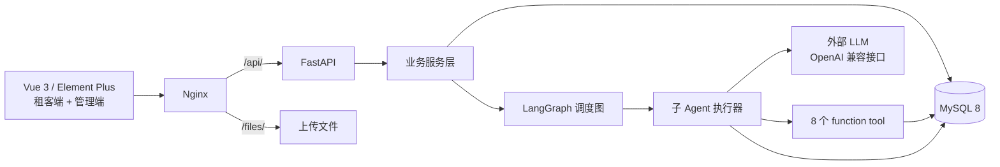

<p align="center">
  
</p>

<h1 align="center">ParingBot</h1>

<p align="center">
  <b>长租公寓智能合租匹配平台</b><br/>
  多维偏好 → 租客画像 → 候选筛选 → 双向审核 → 交付，把一次找室友跑成一条可复盘的多 Agent 流水线
</p>

<p align="center">
  
  
  
  
  
  
  
</p>

<p align="center">
  
</p>

---

**ParingBot 是一个可运行的智能合租匹配演示平台。** 租客填好档案、七维合住偏好和动态后发起匹配，合租管家（主管）每一轮看一遍当前进展，决定把活派给画像师、筛选官还是审核官；候选不够就放宽「加分」项，画像不够就补一版画像，通过审核的人数够了就收尾交付。三个角色之间不直接对话，所有事实从库里现查，模型只负责判断，边界由代码守住。

界面走浅色工作台风格（浅灰渐变底、白色细边框卡片、蓝色强调、药丸标签），设计 token 集中在 `frontend/src/assets/css/global.css`，管理端与租客端共用同一套视觉语言；视觉风格参考了作者的 NewsClaw 项目。

在线演示：本地 Docker 一键起，见[快速开始](#快速开始) · 设计文档：[docs/architecture.md](docs/architecture.md) · 运维手册：[docs/operations.md](docs/operations.md)

---

## 一场匹配如何走完

**① 建档、偏好与动态**

租客填 17 项档案（性别、生日、预算、整洁度、租期、门店、作息、宠物、吸烟、自我介绍、室友期望、生活照等），管理员审核通过后才会进入候选池；七维合住偏好逐项标「必须 / 加分」，其中「必须」维度任何情况下都不放宽。动态是画像师的证据来源。

<p align="center">
  
</p>

**② 发起匹配：先过 11 项前置检查**

点「重新智能匹配」后，平台依次检查档案、自我介绍、偏好、动态、四个角色与 Prompt 是否可用、工具分组是否为空、模型 API Key 是否配置。任何一项不满足都会指出「去哪个页面补哪一项」，不会留下半成品任务。检查通过后建任务与运行记录，后台执行，页面轮询进度。

**③ 主管调度：三个角色各干各的活**

- **画像师**：读档案和动态原文，输出性格 / 生活方式 / 合住需求三类标签；每个标签必须能摘到原文依据，摘不到就丢。
- **筛选官**：按偏好硬筛候选，只找同性、只写档案已审核通过的人；候选人不够时按代码给定的边界放宽「加分」维度（单次/累计/整场三重上限）。
- **审核官**：站在候选方立场反向审核申请方——候选方标「必须」的条件有一条不满足就直接否决；双方习惯直接冲突判「偏好冲突」；资料不足判「画像不足」并点名缺哪个维度。
- 主管看到的是数据库口径的进展快照：候选多少、通过多少、还差几人、上一步的**对账结论**是什么，而不是模型自报。

<p align="center">
  
</p>

**④ 交付与复盘**

一轮运行结束，平台**不采信模型总结**：从库里重新数通过/否决/交付人数，没有可交付候选就判失败并给出两条下一步。每一次调度、每一次工具调用、每一批审核结论都落库，管理端「调度时间线」可以按轮展开看谁在什么时候做了什么、花了多久、走没走通。

<p align="center">
  
</p>

## 能力地图

<table>
<tr>
<td width="50%"><br/><b>智能匹配</b> — 前置检查、2 秒轮询、调度时间线、交付统计</td>
<td width="50%"><br/><b>画像结果</b> — 三类标签、逐标签原文依据、补画像版本</td>
</tr>
<tr>
<td width="50%"><br/><b>双向审核</b> — 通过/否决、三类否决原因、代码复核改判</td>
<td width="50%"><br/><b>Agent 工具中心</b> — 工具注册表、参数 Schema、只读试跑、调用日志</td>
</tr>
</table>

## 核心设计

| | |
|---|---|
| **模型只做判断，代码管边界** | 模型输出结构化 JSON，写库前由代码校验：同性、档案已审核、候选在池内、放宽不超过规则、必调工具确实调过。越界不会静默通过，而是把原因回给模型改。 |
| **hub-and-spoke 调度** | LangGraph 手写 `StateGraph`：主管是唯一中枢，画像/筛选/审核之间没有边，任何交接都经过主管。不是三个模型自由对话。 |
| **状态做薄，数据库是事实源** | `MatchState` 只有 7 个路由字段；画像、候选、审核结论全部落库，下一角色现查。8 轮跑下来上下文不随轮数膨胀。 |
| **以库为准** | 筛选本轮新增、审核通过/否决、最终交付都从库里数；主管的「已经发生的事」优先读角色节点写的**对账结论**；模型自报与库不一致会写进结论。 |
| **代码复核会翻案** | 模型判「通过」后，代码按候选方标为必须的条件复核申请方；验不过（含同性硬规则）的候选当场改判否决，而不是只写一条备注。 |
| **每一步可复盘** | `agent_run` / `agent_step` / `tool_call_log` 三张账本；调度时间线 + 候选漏斗；异常一律翻译成「去哪个页面改哪一项」。 |
| **配置中台** | 模型、Prompt、角色、工具、7 项闸门参数全部入库，运行时现查、改完下一步生效；停用一个工具，模型手里真的没有它。 |
| **可部署、可测试** | Docker Compose 三服务（MySQL + FastAPI + Nginx/Vue）；266 条原有用例 + 新增回归共 **354 条**，AI 流程用 FakeModel 回放，不需要真实 API Key。 |

## 架构



```text
paringbot/
├── backend/                FastAPI + Tortoise ORM + LangGraph
│   ├── ai/                 调度图、子 Agent 执行器、工具、模型/Prompt 加载
│   ├── api/                18 个路由模块（83 条接口 + 根路由）
│   ├── service/            业务服务（匹配/筛选/审核/画像/配置/追踪）
│   ├── models/             16 张表的 ORM 定义
│   └── tests/              pytest（FakeModel 回放，免 API Key）
├── frontend/               Vue 3 + Vite + Element Plus（31 个页面）
├── deploy/mysql/           MySQL 镜像与种子 SQL
├── docker-compose.yml      三服务编排
├── docs/                   架构、运维、截图
└── scripts/                种子生成、部署冒烟
```

## 技术栈

| | |
|---|---|
| **后端** | Python 3.13 · FastAPI · Tortoise ORM · JWT · Pydantic |
| **AI 编排** | LangChain · LangGraph（手写 StateGraph）· OpenAI 兼容接口（默认 DeepSeek） |
| **数据** | MySQL 8 · 16 张表 · 2 次真实运行记录 · 900 位演示租客 / 2,500 条动态 |
| **前端** | Vue 3.4 · Vite 5 · Element Plus 2.8 · axios |
| **部署** | Docker Compose · Nginx 反代 · 健康检查 · 数据卷 |
| **测试** | pytest 8 · pytest-asyncio · FakeModel 回放 · 会话级测试数据清扫 |

## 快速开始

需要 Docker Desktop（含 Compose v2）：

```bash
cp .env.example .env          # 修改数据库口令与 JWT_SECRET
docker compose up -d --build  # 首次构建约 5-15 分钟
docker compose ps             # 三个服务 healthy 后访问
```

打开 <http://127.0.0.1:8080>。演示账号：

| 身份 | 账号 | 密码 |
|---|---|---|
| 管理员 | `admin` | `admin123` |
| 租客 | `member01` | `123456` |

登录后还差最后一步：管理员进入【AI 模型配置】，给「调度 / 画像 / 筛选 / 审核」四个用途填上模型 API Key（可共用一条）。种子配置的 Key 为空，不填时发起匹配会被前置检查拦下并提示去哪里补。

服务健康检查：<http://127.0.0.1:8080/api/> · 接口文档：<http://127.0.0.1:8080/api/docs>

## 怎么验证它真的能跑

```bash
# 容器状态与日志
docker compose ps
docker compose logs --tail=100 backend

# 部署冒烟：健康检查 / 管理员登录 / 权限 / 租客登录 / 上传鉴权 / 路径穿越
python scripts/smoke_check.py --base http://127.0.0.1:8080

# 后端全量测试：真实 MySQL + FakeModel，不需要模型 API Key
docker compose exec -T backend pytest -q
# -> 354 passed

# AI 能力评测（Phase 0）：40 条 golden case + 坏输出自检，不需要模型 Key
python eval/run_eval.py --fixtures --bad eval/fixtures/bad

# 前端构建（镜像构建阶段已执行 npm ci + vite build）
docker compose build web
```

当前基线：**354 项后端测试，0 失败**（2026-10-30，本机 Docker Compose 栈内实测）。测试数量来自 `pytest -q` 尾行统计；AI 相关用例用 FakeModel 按脚本回放，不依赖真实模型。

## 实测与边界

这些数字只代表本机 Docker Desktop 与仓库内演示数据，不是生产容量或 SLA：

- **两条演示运行记录（种子库内置，已按当前口径迁移）**：8 轮调度 / 84 次工具调用 / 82.3 秒 / 33 个候选 → 4 通过、29 否决 → 交付 4（要求 8）；4 轮 / 39 次调用 / 50.3 秒 / 15 个候选 → 7 通过、8 否决 → 交付 7（要求 8）。迁移时把与当前硬规则冲突的历史「通过」（异性候选、复核不满足必须项）改判否决并重写了运行总结，页面、漏斗、交付数字现在是自洽的。
- **演示库**：900 位租客（男女各 450、20 家门店）、2,500 条动态、80 个兴趣标签、2 条演示运行记录；历史数据已按当前口径迁移，新发起的匹配同样走修复后的硬校验。
- **模型调用**：仓库不包含任何 API Key；不填 Key 只能浏览页面、管理配置和跑测试，不能发起真实匹配。
- **安全边界**：密码为 PBKDF2 哈希、上传鉴权+魔数校验、登录失败限流、改密吊销旧 JWT、分页限幅、nginx 安全响应头、用户名列表仅管理员可见；但这是**单人本机演示栈**，仍缺审计日志、备份策略与公网加固，不要直接暴露到公网。
- **运行期**：匹配任务跑在 FastAPI BackgroundTasks 里，单进程、无队列、无重试；服务重启时会把悬挂运行标记为失败（前端会提示重新发起）。单次运行默认 600 秒超时。

## 这个仓库里没有什么

- **没有真实房源/租约/合同/支付**：只有租客档案、偏好、匹配与审核；不是完整的公寓租赁业务系统。
- **没有生产级高可用**：单机 MySQL + 单进程后端，没有多副本、消息队列和跨城容灾；登录限流是进程内实现，不跨实例。
- **没有真实住户数据**：演示租客、动态、运行记录均为种子数据。
- **没有随仓库分发的模型密钥**：`.env` 与任何 Key 都不进版本控制，仓库只保留 `.env.example`。
- **前端只有 Playwright 只读冒烟**：CI 的 `e2e` job 会启动整套 Compose 后跑登录/路由/页面/404/错误态用例；没有前端单元测试（截图来自真实 Docker 栈）。

## 工程文档

- 架构与调度链路：[docs/architecture.md](docs/architecture.md)
- 部署、配置与故障处理：[docs/operations.md](docs/operations.md)
- 部署冒烟脚本：[scripts/smoke_check.py](scripts/smoke_check.py)
- 种子库生成说明：[scripts/prepare_seed.py](scripts/prepare_seed.py)
- AI 能力评测（Phase 0）：[eval/README.md](eval/README.md)
- 真实模型评测指南（Key/模型怎么填、怎么跑）：[eval/RUNBOOK.md](eval/RUNBOOK.md)
- 真实模型评测结果（DeepSeek / Qwen 对比）：[eval/RESULTS.md](eval/RESULTS.md)
- 前端 Playwright 冒烟：[e2e/README.md](e2e/README.md)
- 自动质量检查（硬规则/汇总一致性/证据覆盖）：[eval/quality_checks.py](eval/quality_checks.py)

## 截图

全部页面截图在 [`docs/assets/screenshots/`](docs/assets/screenshots/)：登录、租客端首页/档案/智能匹配/候选结果/审核结果/画像结果、管理端首页/调度时间线/工具中心/用户管理，均由本机 Docker Compose 栈（1440×900）实时截取；前端视觉规范见 [`docs/frontend-style.md`](docs/frontend-style.md)。
