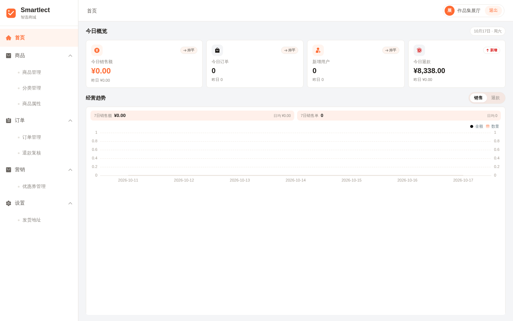
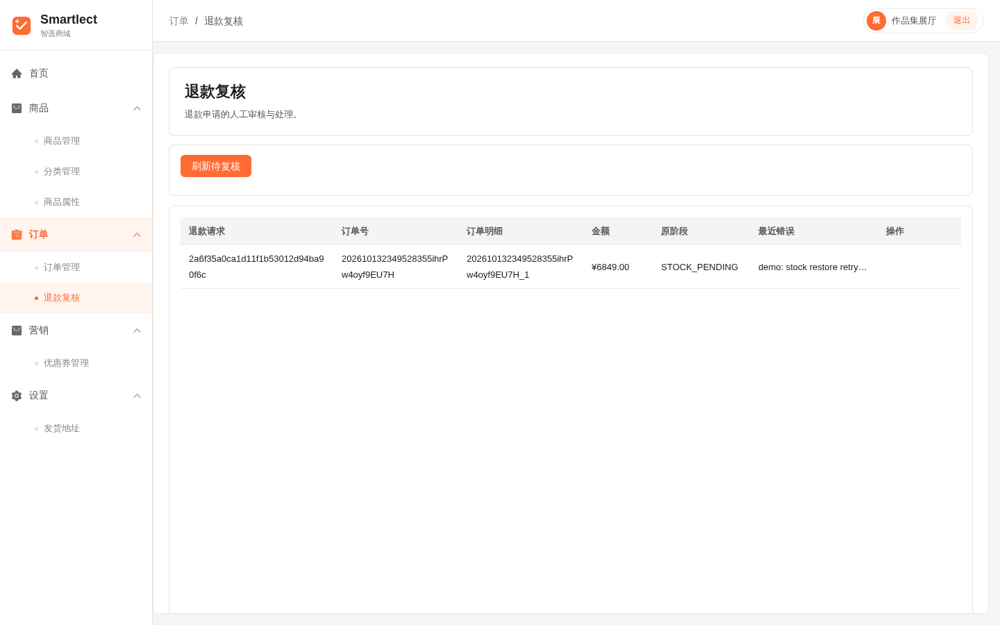
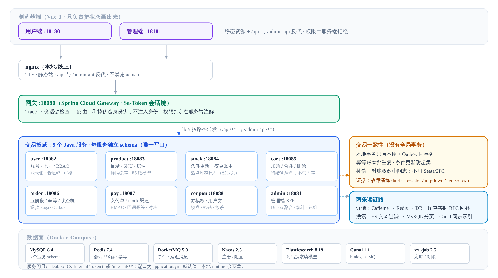
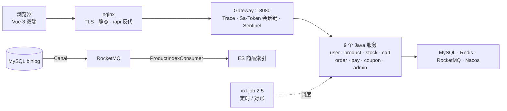

<p align="center">
  
</p>

<h1 align="center">Smartlect</h1>

<p align="center">
  <b>一家店，九个 Java 服务，一套最终一致性</b><br/>
  C 端商城 + 商家后台，交易、库存、订单、支付、退款全在 Java 后端
</p>

<p align="center">
  
  
  
  
  
  <a href="https://github.com/LittleSongxx/Smartlect/actions/workflows/ci.yml"></a>
</p>

<p align="center">
  
</p>

---

**Smartlect 是一套可演示的单店 Java 交易后端。** 浏览器只负责把状态画出来；商品、库存、购物车、优惠券、订单、支付、退款分别由 9 个 Spring Boot 服务负责。每个服务只写自己的 schema，跨服务一致性靠本地事务 + Outbox + 幂等账本 + 补偿 + 对账收敛。

支付是本地模拟，不接真实渠道；没有真实资金，也没有把 mock 支付当成生产支付。

线上可以直接点：[用户端](https://smartlect.cn/) · [管理端](https://smartlect.cn/admin/)。

**对外演示账号是公开的，权限在服务端按身份拒绝。** 不要用仓库或环境里的超管。登录页默认填的是可下单的演示买家。

| 端 | 账号 | 密码 | 能做什么 | 不能做什么 |
| --- | --- | --- | --- | --- |
| 用户端 | `shopper@smartlect.demo` | `Visit-Smartlect-2026` | 逛店、加购、模拟下单（已预置收货地址和体验券） | 改密、改资料、注册新号 |
| 用户端 | `visitor@smartlect.demo` | `Visit-Smartlect-2026` | 逛店、看商品 | 下单、加购、改密、改地址、注册新号 |
| 管理端 | `gallery` | `Visit-Smartlect-2026` | 看板、商品、订单、退款复核 | 改库存、发券、发货、管账号、看用户隐私 |

---

## 一笔订单在 Java 后端里怎么走

<table>
<tr>
<td width="33%" valign="top">

**① 逛店与加购**

首页、分类、搜索、商品详情都读商品域。详情走 Caffeine L1 + Redis L2，库存不进缓存；搜索走 ES 文本过滤，再回 MySQL 做分类、价格、排序和分页。

购物车只保存“想买什么”：唯一键合并、数量累加、不锁库存。

</td>
<td width="33%" valign="top">

**② 下单**

订单服务按五阶段编排：读准备 → 锁券 → 短本地事务 → 事务外扣库存/建支付意图 → 失败补偿。

订单、明细、物流、券关系和 15 分钟关单消息写在同一个本地事务里；库存扣减用条件更新，重复请求由幂等账本挡住。

</td>
<td width="33%" valign="top">

**③ 支付与售后**

支付服务维护自己的支付单，支付成功发事件；订单服务收到事件后 CAS 订单状态、核销券。订单已关闭后的迟到支付原路退款。

退款是持久化 Saga：按明细退、支付确认、库存回补、整单全退才退券；失败可重试，耗尽转人工复核。

</td>
</tr>
</table>

<table>
<tr>
<td width="50%"><br/><b>商品详情</b> — 规格、价格与实时库存；选规格时才向库存服务取数</td>
<td width="50%"><br/><b>购物车</b> — 唯一键合并；加购价只是展示快照，结算按商品快照重新计价</td>
</tr>
<tr>
<td width="50%"><br/><b>结算</b> — 地址、优惠券、支付方式在提交前一次确认</td>
<td width="50%"><br/><b>下单之后</b> — 状态以订单域为准；可继续支付、取消或申请退款</td>
</tr>
</table>

---

## 后台看的是同一份数据

管理端不做第二套真相：订单状态以订单域为准，商品上下架改的是商品域，库存以库存服务为准。`admin` 服务只做 Dubbo 聚合、统计、设置和运维出口。

<table>
<tr>
<td width="50%"><br/><b>看板</b> — 今日订单/销售额/用户/商品与近 7 日曲线，数据来自各域聚合</td>
<td width="50%"><br/><b>订单</b> — 状态流转、发货、买家信息默认隐藏；写操作回到订单域</td>
</tr>
<tr>
<td width="50%"><br/><b>退款复核</b> — 支付/库存重试耗尽的退款单转人工，可 approve/reject</td>
<td width="50%" valign="top">

**权限边界**

用户端和管理端是两套 Sa-Token realm：用户 `token`，管理端 `adminToken`。网关只校验会话键存在性，角色、权限点和数据归属由服务端判定。

公开演示的 `gallery` 账号默认只读；退款复核是显式放行的例外。写接口必须有权限注解，CI 有授权门禁。

</td>
</tr>
</table>

---

## 架构

<p align="center">
  
</p>

浏览器只负责把状态画出来；真正改价格、扣库存、落订单、退款的只有 Java。网关不做业务鉴权，也不向下游注入身份头；下游从 Sa-Token 会话重新取身份。



**三条主链**

| 链路 | 路径 |
|---|---|
| 浏览 | nginx → Gateway（会话键/限流）→ product → Caffeine L1 → Redis L2 → MySQL；未命中回源，库存实时回补 |
| 交易写 | Gateway → order → product 快照 / coupon 锁券 / stock 条件扣减 / pay 支付意图；本地事务只覆盖订单库，远程写幂等 + 补偿 |
| 异步读模型 | MySQL binlog → Canal → RocketMQ → ProductIndexConsumer → ES；同时失效商品详情缓存 |

**一致性没有用分布式事务框架。** 本地事务 + 事务性 Outbox 投递到 RocketMQ 做最终一致；订单幂等账本挡住重复提交，库存用条件更新 + 变更账本，延迟消息关单，补偿日志和 xxl-job 负责重放与对账。关键取舍与证据见 [ADR 索引](docs/adr/README.md)。

---

## 技术栈

| | |
|---|---|
| **前端** | Vue 3 · Vite · Element Plus · TypeScript（用户端）· JavaScript（管理端） |
| **交易** | Java 17 · Spring Boot 3.5 · Spring Cloud Alibaba 2025 · Dubbo 3.3 · 9 个服务 · MyBatis + PageHelper |
| **鉴权** | Sa-Token 1.39（双 realm；网关读会话键 + 服务端 `@SaCheckLogin` / `@SaCheckPermission`） |
| **缓存** | Caffeine L1 + Redis L2 + pub/sub 失效 + Canal 兜底 |
| **搜索** | Elasticsearch 8.19（IK/standard 分词 + 商品索引）；ES 不可达时回退 SQL LIKE |
| **消息** | RocketMQ 5.3（Outbox 可靠投递 · 15min/1h/7d 延迟消息 · 消费幂等 · 补偿重放） |
| **变更捕获** | Canal 1.1.8（MySQL binlog → RocketMQ → ES 商品索引与缓存失效） |
| **调度** | xxl-job 2.5（Outbox 兜底投递按库、订单超时、支付轮询/日对账、秒杀与退款对账、幂等账本上报、补偿重放） |
| **服务治理** | Nacos 2.5（服务发现 + 配置中心）· Redisson 4.0（锁/限流）· Sentinel（网关/ Dubbo 规则） |
| **基础设施** | MySQL 8.4 · Redis 7.4 · RocketMQ 5.3 · Nacos 2.5 · Elasticsearch 8.19(IK) · Canal 1.1.8 · xxl-job 2.5 |

```
backend/   gateway · user · product · stock · cart · order · pay · coupon · admin
web/       用户端与管理端（Vue 3）
deploy/    容器编排（compose）· nginx · SQL 初始化 · 集群编排
scripts/   dev.sh 入口 · runtime.py 进程编排 · 压测/故障演练/校验工具
eval/verification/  压测、演练与发布证据（按日期归档）
docs/      改动记录（按日归档）· ADR · 架构图/截图
```

---

## 快速开始

```bash
./scripts/dev.sh bootstrap     # 探测空闲端口、生成本机凭证（run/runtime.env，权限 600）
./scripts/dev.sh build         # 编译 Java + 双前端
./scripts/dev.sh infra-up      # 起 MySQL/Redis/RocketMQ/Nacos/ES/Canal/xxl-job 并等待健康
./scripts/dev.sh up            # 按依赖顺序拉起应用进程与前端
```

用户端 [http://127.0.0.1:18180/](http://127.0.0.1:18180/)，管理端 [http://127.0.0.1:18181/admin/](http://127.0.0.1:18181/admin/)。需要一套示例货架时再执行 `./scripts/dev.sh seed-store`。

端口由 bootstrap 探测空闲值并写进 `run/runtime.env`，下表是默认值：

| 层 | 端口 |
|---|---|
| 中间件 | MySQL 13306 · Redis 16379 · RocketMQ gRPC 8081 · Nacos 18848 · ES 9200 · Canal 11111 · xxl-job 18090 |
| Java | gateway 18080 · admin 18081 · user 18082 · product 18083 · stock 18084 · cart 18085 · order 18086 · pay 18087 · coupon 18088 |
| 前端 | 用户端 18180 · 管理端 18181 |

本地 `run/runtime.env` 可能把 Java 端口覆盖为 `18101–18108`、网关覆盖为 `18082`；以启动日志和 `run/runtime.env` 为准。

已经部署的副本：[用户端](https://smartlect.cn/) · [管理端](https://smartlect.cn/admin/)。试用账密见上文，超管密码不在此公开。

---

## 怎么验证它真的能跑

仓库带 [CI](https://github.com/LittleSongxx/Smartlect/actions/workflows/ci.yml)，backend 一档跑的是**集成档而不是单测档**：`mvn -Pintegration verify`（单测 + 9 个 Testcontainers IT + JaCoCo），再加覆盖率棘轮和管理端授权门禁：

```bash
mvn -B -f backend/pom.xml -Pintegration verify   # 单测 + 真库 IT（Outbox 租约、金额分摊、下单一致性…）
python3 scripts/coverage_gate.py                  # 行覆盖率对比 backend/jacoco-baseline.txt（±1pp 容差）
python3 scripts/check_admin_authz.py              # 管理端写接口必须权限注解/二次确认/展厅拒绝清单
```

本地三栈自检（Java 单测 · 双前端 vitest · 运行时自测与进程独立性检查）：

```bash
./scripts/dev.sh check
```

运行时门禁单独也能跑，部署前后各来一次：

```bash
./scripts/dev.sh infra-check    # 中间件健康 + 权限隔离（app/flyway 只能碰自己的库）
./scripts/dev.sh apps-check     # 应用进程健康 + Nacos 注册数
python3 scripts/xxljob_setup.py # 幂等登记调度任务（只加注解不会执行）
```

**故障演练**（可复跑，产物可直接归档）：

```bash
python3 scripts/drills/fault_drills.py all
```

覆盖：并发同幂等键下单（幂等账本 + 条件扣减）、停 RocketMQ（下单仍成立、消息滞留 Outbox、恢复后自动投递）、停 Redis（鉴权 fail-closed、商品详情回源 DB、恢复后会话仍有效）。

**压测方法与证据**：`scripts/loadtest/README.md` 记录了发压器、预热、业务错误统计、拐点口径和踩过的坑；浏览链路与订单链路的原始 JSON 在 `eval/verification/`。注意低并发/预热/发压机差异，不要把本地数字当生产容量。

---

## 指标与观测

每个服务都暴露 `/actuator/prometheus`（health/info/prometheus 三件套，只从内网抓；nginx 不反代 `/actuator`）。业务指标走 `com.smartlect.metrics.SmartlectMetrics` 单一出口，命名约定 `smartlect_<域>_<事件>_total`，标签只放有限基数维度：

| 指标 | 类型 | 含义 |
|---|---|---|
| `smartlect_product_cache_total{layer,result}` | Counter | 商品详情缓存：`layer=l1/l2/db`，`result=hit/miss/error/load`；L1 另有 Caffeine `cache_*` |
| `smartlect_order_created_total` | Counter | 下单成功（按子单数累加，Phase 3 短事务提交即计） |
| `smartlect_idempotent_replay_total{command}` | Counter | 幂等重放命中（同键重复请求返回既有结果） |
| `smartlect_idempotent_conflict_total{command,reason}` | Counter | 幂等冲突：`in_flight/stale_processing/inconclusive/manual_review/fingerprint_mismatch` |
| `smartlect_idempotent_stuck_total{status}` | Counter | 幂等账本“待核对/待人工/陈旧 PROCESSING”积压 |
| `smartlect_stock_insufficient_total` | Counter | 库存不足（条件更新 0 行，防超卖的正常拒绝） |
| `smartlect_outbox_dispatch_total{result}` | Counter | Outbox 投递：`sent/failed/parked`（`parked` = 撞 broker 时间轮上限，驻留待重投） |
| `smartlect_mq_compensation_replayed_total` | Counter | 补偿日志自动重放成功条数 |
| `smartlect_sql_slow_total{mapper}` | Counter | 慢 SQL（默认 200ms）；只记 mapperId 与 SQL 骨架，不记参数 |
| `smartlect_mq_outbox_exhausted` | Gauge | 重试耗尽、需人工重放的消息数（长期 >0 要处置） |
| `smartlect_pay_reconcile_diff_total{type}` | Counter | 支付日对账差异（本地支付单/退款/渠道账本），不自动改账 |
| `smartlect_stock_hot_reserve_total{result}` | Counter | 热点库存原型：`reserved/insufficient/fallback`（Redis 故障时回退 DB；默认关） |
| `smartlect_stock_hot_reconcile_diff_total` | Counter | 热点库存桶总和与 DB 不一致的次数（只在无活跃预占时按 DB 重建） |
| `executor_*{name=smartlect.mq.async / smartlect.coupon.cache.rebuild}` | Gauge/Counter | 自定义线程池：活跃线程、队列深度、完成数、拒绝数 |
| `hikaricp_*` · `tomcat_threads_*` · `jvm_*` | Boot 默认 | 连接池、容器线程、JVM（GC / 内存） |

日志带 `traceId`（网关入口 → MDC → 跨 MQ/Dubbo/线程池传播），手机号/邮箱等字段在落盘前脱敏。

---

## 运维与排查入口

| 入口 | 在哪 | 用途 |
|---|---|---|
| 站点 | `http://127.0.0.1/` | nginx 反代网关，`/actuator` 与业务端口不对公网开放 |
| 网关健康 | `:18080/actuator/health` | 依赖 Redis / Nacos 的存活探针 |
| 调度中心 | `:18090/xxl-job-admin` | 任务执行记录、手动触发、失败重试；判断“任务在跑”看 `handle_code=200`，只看触发会漏掉“调度成功但执行器不可达” |
| 展厅账号策略 | `TrialAdminAccess` + `TrialAdminGuardInterceptor` | 公开口令的 gallery 账号：读默认允许（隐私清单除外）、写默认拒绝（退款复核显式放行）；写接口必须自带 `@SaCheckPermission` |
| 配置中心 | `:18848` Nacos 控制台 | `SMARTLECT_GROUP` 下的配置；改完用 `scripts/nacos_config_push.py` 推送 |
| 指标 | 各服务 `/actuator/prometheus` | JVM / Hikari / 线程池 / 业务指标；只从内网抓 |
| 应用日志 | `run/logs/<服务>.log` | 启动失败先看这里；`run/logs/<服务>/nacos/` 是注册与配置客户端日志 |
| MQ 补偿 | 各库 `mq_compensation_log` | 发送失败/远程补偿由 `mqCompensationReplay` 自动重放；消费失败默认留人工，coupon 的退款还券幂等，可开自动重放 |
| Outbox 水位 | 各库 `local_message_outbox` | 积压说明投递侧异常；`EXHAUSTED` 需人工介入 |
| 付款对账 | `payDailyReconcile` | 对比支付单/退款/渠道账本，只出差异报告，不自动改账 |
| 订单状态历史 | `GET /admin-api/order/{orderId}/statusLog` | CAS 成功后同事务追加；创建、支付、发货、退款、关单可串成一条时间线 |
| 部署后核对 | `scripts/probes/post_deploy_check.sh https://smartlect.cn` | 展厅矩阵 + 多节点交替检测：同一路径在期望码与其它码之间交替，说明有副本节点未更新 |

服务起不来时的顺序：`run/logs/<服务>.log` 找首个异常 → `infra-check` 确认中间件 → `apps-check` 确认注册数 → 调度类问题看 xxl-job 控制台。

---

## 关键决策

这些都是“选择 A 不选 B”的判断，取舍、代价和重审条件写在 ADR 里：

| 决策 | 选择 | 理由与代价 | ADR |
|---|---|---|---|
| 一致性 | **不用分布式事务框架**，本地事务 + Outbox | 双轨回滚边界不可推理；代价是自建幂等、补偿、对账，并接受短暂不一致 | [0001](docs/adr/0001-transaction-consistency.md) |
| 下单 | **五阶段 + 短本地事务** | 远程调用不占数据库连接；代价是 P4 失败要补偿、订单会真实存在 | [0002](docs/adr/0002-order-write-path.md) |
| 库存 | **条件更新 + 变更账本** | 单条 UPDATE 原子判断 + 扣减；代价是热点 SKU 行锁瓶颈 | [0003](docs/adr/0003-stock-conditional-update.md) |
| 消息 | **Outbox + RocketMQ + 消费幂等** | 业务与消息同生共死；代价是 at-least-once 与 DB 扫描 | [0004](docs/adr/0004-reliable-messaging.md) |
| 订单状态 | **CAS + 支付生命周期锁** | 非法迁移拒绝、并发竞争可解释；0 行需要调用方解释 | [0005](docs/adr/0005-order-state-machine.md) |
| 退款 | **持久化 Saga + 人工复核** | 可恢复、可审计；中间态会存在，部分退款不退券 | [0006](docs/adr/0006-refund-saga.md) |
| 数据边界 | **每服务 schema，缓存/ES 是读模型** | 服务边界清晰；单 MySQL 仍是单点，CDC 有延迟 | [0007](docs/adr/0007-data-boundaries.md) |
| 鉴权 | **双 realm + 网关只验会话键** | 权限能表达数据归属；内部令牌是共享令牌（已知风险） | [0008](docs/adr/0008-auth-and-internal-calls.md) |
| 观测/安全 | **Trace/指标/脱敏/慢 SQL/限流** | 能定位、成本低；没有完整 APM/SLO/混沌 | [0009](docs/adr/0009-observability-and-security.md) |
| 热点库存 | **原型默认关闭，DB 是事实源** | 为 Redis/Lua/分桶留演进路径；复杂度高，只在特定 SKU 开启 | [0010](docs/adr/0010-hot-stock-evolution.md) |

---

## 已知边界与遗留

- **演示规模**：单机 MySQL、演示目录（47 个商品 / 20 SKU 场景 + 8.7 万条索引）。浏览链路压测：集群峰值 832 req/s @1600 并发，p95 4655ms；可持续档 811 req/s @600 并发，p95 ≈200ms；发压工具自身有已知偏高口径。不是生产流量。
- **订单链路压测**：本地单机 10/20 VU、30 秒、加购→下单→支付全链，0 业务错误；p95 分别为 67.6/57.3 ms（热点库存默认关）。热点库存开时 60.9/61.9 ms，差异在噪声内；这是低并发回归信号，不是容量结论。方法、库存守恒核对与原始 JSON 见 [订单链路压测](docs/verification/order-load.md)。
- **MQ 是单点**：DLedger 三副本编排已就绪但线上未启用。
- **Outbox 兜底按库注册**：`outboxDispatch` 在 order/user/product/cart/pay/admin 六个库各登记一份；其余域没有 `local_message_outbox`。
- **幂等账本无业务参数**：`INCONCLUSIVE / MANUAL_REVIEW` 不能自动改判，需运维带业务参数核对；要自动闭环需要在业务行冗余幂等键（未做）。
- **Sentinel 规则热更**（Nacos 数据源）已完成代码侧，线上演练未做。
- **xxl-job 地址链**：应用在宿主机、调度中心在容器，两端都要能被对方访问；任一环节错会表现为“触发成功但任务不执行”。
- **`/internal/**` 是共享令牌**（接受风险）：内部面只校验一枚 `X-Internal-Token`；改成 per-service 令牌/签名 actor 需要重做全部调用约定。
- **mock 支付**：有支付单、事件、迟到退款、HMAC 签名、nonce 防重放和日对账；但没有真实渠道、清算/结算和资金账本，不能当生产支付用。mock 模式下生产环境未设置 `SMARTLECT_MOCK_PAY_SECRET` 时启动会失败，而不是静默退回开发密钥；pay、assistant 与脚本必须使用同一密钥。
- **`coupon_scope` 未在结算校验**：订单 DTO 没有 scope 字段，`coupon_scope` 目前只服务商品推荐侧的估算；锁券/核销只校验模板状态、有效期和门槛。
- **热点库存原型默认关闭**：`smartlect.stock.hot-path.enabled=false`；只对配置的 SKU 生效，DB 仍是事实源。不是生产级高并发库存。
- **资源 id 用非 CSPRNG**（`StringTools.getRandomNumber`，ThreadLocalRandom）：不可从外部预测；邮件验证码已切 SecureRandom。

## 这个仓库里没有的东西

- **没有真实资金。** 支付是本地模拟：不接第三方、不跳转、不会扣款。
- **没有公开超管密码。** 演示账号权限在服务端裁剪；仓库里的超管凭证只对本地环境有效。
- **没有分布式事务框架。** 一致性靠本地事务 + Outbox + 幂等键 + 补偿 + 对账，不是两阶段提交。
- **没有分库分表/单元化/多活。** 单 MySQL + 8 个业务 schema；规模上来后的演进路径写在 ADR-0010 与各 ADR 的“何时重审”。
- **没有真实流量/生产容量结论。** 压测是本地三节点/低并发证据，口径写在 `scripts/loadtest/README.md` 与 `eval/verification/`。

---

## 许可

仓库根目录**没有** `LICENSE` 文件。`backend/`、`web/user/`、`web/admin/` 下的子模块各自为 **MIT**。
