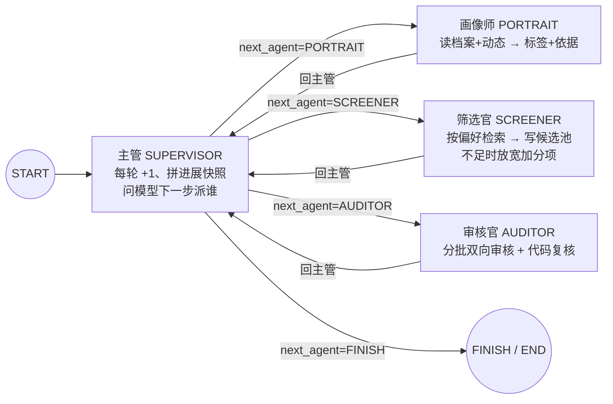
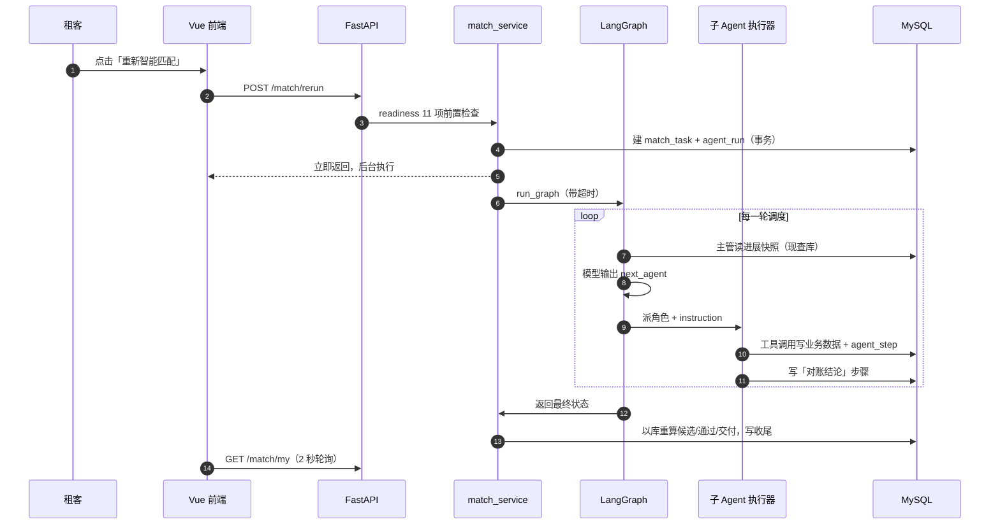

# ParingBot 架构与调度链路

本文说明 ParingBot 的分层、多 Agent 调度、数据模型与工程口径。阅读顺序建议：调度图 → 一次匹配时序 → 数据模型 → 闸门与配置 → 目录结构。

## 根约束：模型只做判断，代码管边界，数据库是唯一事实源

大模型的输出不可靠（会漏项、会谎报、会违反硬规则），而合租匹配的每一步都必须可追溯、可复现、可解释。ParingBot 的全部设计都从这条约束推出来：

1. **不让 Agent 自由对话**：hub-and-spoke 调度图，主管是唯一中枢，三个角色之间没有边，任何交接都经过主管。
2. **不把事实塞进上下文**：`MatchState` 只有 7 个路由字段；画像、候选、审核结论全部落库，下一角色自己现查。
3. **模型不能直接产生副作用**：8 个 function tool 是唯一写入口，写库前由代码校验（同性、档案已审、放宽边界、池内归属）。
4. **模型结论不能当事实**：代码复核、以库计数、对账告警、画像标签必须能摘到原文。
5. **长链路一定中断**：每一步落 `agent_step` / `tool_call_log`，服务启动时把悬挂运行收尾。
6. **调优不靠改代码**：模型、Prompt、角色、工具、闸门参数全部入库，运行时现查。

## 调度图



- 终止条件：主管说 FINISH；轮次超过 `SUPERVISOR_MAX_ROUND`（默认 12，代码强制）；LangGraph `recursion_limit`；任何异常导致运行失败。
- 角色差异只来自表：Prompt、工具分组、工具上限、模型用途分别由 `agent_definition` / `function_tool` / `ai_model_config` 决定。
- 子 Agent 执行器是统一的 ReAct 循环：工具总次数、同工具连续次数、必调工具、JSON 结构化结论四类硬约束，触发不崩溃而是把原因带回主管。

## 一次匹配的时序



主管的「已经发生的事」优先读角色节点写入的**对账结论**（数据库口径），而不是模型自报的结论；旧数据回退到模型结论。

## 数据模型（17 表，无物理外键）

| 域 | 表 | 说明 |
|---|---|---|
| 账号 | `user` | 账号/角色/状态；密码存 PBKDF2 哈希 |
| 租客 | `member_profile` / `roommate_preference` / `member_moment` / `member_portrait` | 档案（审核前置）、7 维偏好（必须/加分）、动态、画像版本 |
| 词表 | `interest_tag` | 80 个兴趣标签，画像只能从词表选 |
| 匹配 | `match_task` / `match_candidate` | 任务状态机；候选池（初筛分、放宽说明、审核结论、否决分类） |
| 运行 | `agent_run` / `agent_step` / `tool_call_log` | 运行总账 / 每步记录 / 每次工具调用 |
| 配置 | `ai_model_config` / `prompt_template` / `agent_definition` / `function_tool` / `sys_config` | 模型、Prompt、角色、工具、闸门参数 |
| AI 能力 | `ai_assist_log` | 资料教练/解读官等助手调用留痕：场景、Prompt 哈希、模型、耗时、tokens、是否采纳；只存摘要不存原文 |

完整性由应用层 + 12 个唯一索引保证；`MatchCandidate(task_id, candidate_member_id)`、`MemberPortrait(member_id, version)` 在 ORM 中登记为 `unique_together`，业务关键多写序列在事务中提交。

## 闸门与系统参数

| 参数 | 默认 | 作用 |
|---|---|---|
| `SUPERVISOR_MAX_ROUND` | 12 | 调度轮次上限 |
| `PORTRAIT_MAX_VERSION` | 2 | 单次任务最多补几版画像 |
| `SCREENER_MAX_RELAX` | 3 | 整场最多放宽几轮加分项 |
| `AGENT_MAX_TOOL_CALL` | 30 | 单角色单次执行工具调用上限（角色可覆写） |
| `AGENT_MAX_SAME_TOOL` | 10 | 同一工具连续调用上限 |
| `POOL_CANDIDATE_LIMIT` | 30 | 单轮写入候选池上限 |
| `MATCH_DELIVER_COUNT` | 8 | 默认交付人数 |

适配度：模型负责判断，代码负责拒绝越界。审核官判「通过」后，代码会用候选方标为「必须」的条件复核申请方；不满足则直接改判否决（而不是只写一条备注）。

## 目录结构

```
paringbot/
├── backend/                FastAPI + Tortoise + LangGraph
│   ├── ai/                 调度图、执行器、工具、模型/提示词加载
│   ├── api/                18 个路由模块
│   ├── service/            业务服务（匹配/筛选/审核/画像/配置…）
│   ├── models/             Tortoise ORM
│   └── tests/              pytest（FakeModel，免 API Key）
├── frontend/               Vue3 + Vite + Element Plus（租客端 / 管理端）
├── deploy/mysql/           MySQL 镜像与种子 SQL
├── docker-compose.yml      三服务：mysql / backend / web
└── scripts/                种子生成、部署冒烟
```
